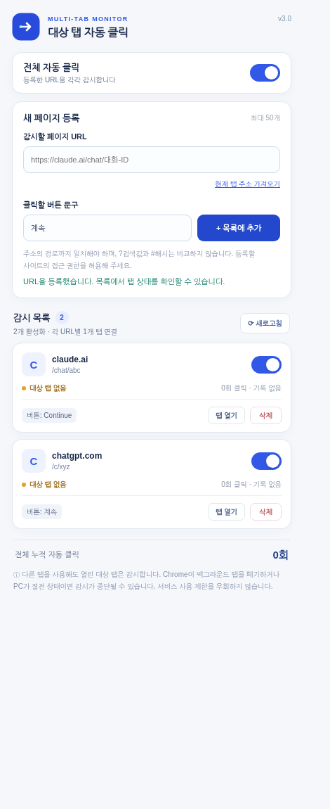

<div align="center">


# Target Tab Auto Clicker

### 원하는 페이지의 `계속` 버튼을 자동으로 감시하세요

**여러 URL 등록 · 개별 ON/OFF · 탭 재연결 · 클릭 기록**

   

Chrome에서 지정한 웹페이지의 버튼이 비활성화되었다가 활성화되면 자동으로 클릭하는 **무료·로컬 실행** 확장프로그램입니다. 별도의 서버나 계정이 필요하지 않습니다.

[빠른 GitHub 공개](#-windows-cmd로-github에-올리기) · [설치 방법](#-설치-방법) · [사용 방법](#-사용-방법) · [문제 해결](#-문제-해결)

</div>

---

## 📸 Preview

<div align="center"></div>

> 예시 이미지는 개인 대화 내용이 없는 설명용 데이터입니다. 이 프로젝트는 ChatGPT·Claude 등 외부 서비스와 무관한 독립 도구입니다.

## ✨ Features

| 기능 | 동작 |
|---|---|
| **URL 목록** | 최대 **50개**의 웹페이지 주소 등록·삭제. 동일한 `origin + pathname` 중복 등록 방지 |
| **버튼 문구 지정** | URL별로 `계속`, `Continue` 등 텍스트 설정 |
| **개별/전체 ON·OFF** | 한 주소만 중단하거나 전체 감시 중지 가능 |
| **탭 추적** | 각 URL에 **일치하는 탭 1개**를 연결하고 닫았다 다시 열면 재연결 |
| **백그라운드 감시** | 다른 탭을 사용하더라도 대상 탭이 실행 중이면 상태 감시 |
| **조건부 클릭** | Chrome의 `disabled`, `aria-disabled`, `data-disabled`, `pointer-events` 및 DOM 변경 확인 |
| **중복 클릭 방지** | 동일한 버튼이 계속 표시되는 동안 반복 클릭하지 않도록 설계 |
| **상태 및 통계** | 탭 없음, 활성화 대기, 클릭 완료, 감시 중지와 URL별 클릭 횟수 표시 |
| **로컬 저장** | URL과 설정·클릭 통계를 `chrome.storage.local`에 저장. 전송용 백엔드 없음 |

## 🚀 Windows CMD로 GitHub에 올리기 — 기존 `github-bootstrap.cmd` 방식

이 프로젝트는 **익숙한 CMD 배포 방식**을 사용합니다. PowerShell 배포 스크립트 없이 Git for Windows + GitHub CLI만 사용합니다. 확장프로그램은 GitHub Pages 자체에서 실행되는 것이 아니라 Chrome에 설치됩니다. Pages는 안내·다운로드 사이트입니다.

### 준비 (최초 1회)

1. [Git for Windows](https://git-scm.com/downloads/win), [GitHub CLI](https://cli.github.com/) 설치 후 CMD를 다시 엽니다.
2. 로그인되지 않았다면 실행 중 `gh auth login --web --git-protocol https`를 통해 브라우저에서 로그인합니다.
3. Git 커밋 이름과 이메일을 최초 한 번만 설정합니다.

```bat
git config --global user.name "Your Name"
git config --global user.email "your-email@example.com"
```

GitHub에서 제공하는 [비공개 커밋 이메일](https://docs.github.com/en/account-and-profile/how-tos/email-preferences/setting-your-commit-email-address)을 사용해도 됩니다.

### 1. 최초 업로드 — `github-bootstrap.cmd`

프로젝트 폴더의 **`github-bootstrap.cmd`를 더블클릭**합니다. 기본 저장소 이름은 `target-tab-auto-clicker`입니다. 사용자의 GitHub 로그인 계정을 자동 확인합니다.

CMD에서 원하는 저장소 이름을 지정할 수도 있습니다.

```bat
github-bootstrap.cmd
github-bootstrap.cmd my-auto-clicker
github-bootstrap.cmd ko9ma7/target-tab-auto-clicker
```

또는 `github-bootstrap.cmd` 상단의 `set "REPO_NAME=target-tab-auto-clicker"` 값을 원하는 이름으로 변경하세요. 이전에 사용하던 `publish.cmd` 역시 동일한 CMD 배포 프로그램을 실행하는 호환용 파일입니다.

동작 순서: Git/gh 확인 → **현재 폴더에 독립 `.git` 초기화** → GitHub 로그인 확인 → 업로드 예정 파일 목록 출력 → `Y` 확인 → 커밋 → 공개 저장소 생성(이미 있으면 재사용) → 안전한 동기화·푸시 → **About Description/Website/Topics 설정** → Pages의 Actions 방식 활성화 시도.

**공개 업로드 주의:** 스크립트는 새 저장소를 기본적으로 Public으로 만듭니다. 공개할 수 없는 코드·개인정보가 있는지 파일 목록을 확인하고 `Y`를 누르세요. `gh` 로그인 토큰이나 암호를 소스에 기록하지 않습니다. 기존 저장소의 공개/비공개 상태는 변경하지 않습니다.

### 2. 이후 업데이트 — `github-update.cmd`

처음 업로드가 성공했다면 동일한 프로젝트 폴더에서 `github-update.cmd`를 더블클릭합니다.

```bat
github-update.cmd
```

기존 저장소에 연결된 `.git`과 `origin`을 확인한 다음 동일한 안전한 배포 절차를 사용합니다. `main`에 푸시되면 GitHub Actions가 Pages 웹사이트 및 설치용 ZIP을 다시 빌드합니다. 기본 저장소 이름을 처음과 다르게 지정했다면 업데이트 실행 시 같은 이름을 명시하세요.

### 3. 원격 저장소 동기화 — `git-safe-sync.cmd`

최초 업로드와 업데이트 과정에서 자동 호출합니다. 원한다면 프로젝트 폴더에서 별도로 실행할 수 있습니다.

- GitHub에 `main`이 없으면 일반 `git push -u origin main`
- GitHub `main`이 로컬 이력의 조상이면 일반 푸시
- 로컬 커밋 없이 원격만 앞서면 `fast-forward` 동기화
- **서로 다른 이력 또는 로컬·원격 모두 변경되었으면 중단** (강제 푸시·자동 이력 덮어쓰기 없음)

### `C:\Users\...`가 다른 Git 저장소라는 오류가 발생하면?

첨부하신 예전 `github-bootstrap.cmd`처럼 이 배포 스크립트도 **먼저 프로젝트 폴더에서 `git init -b main`**을 수행하고, `git rev-parse --show-toplevel`이 **정확히 프로젝트 폴더**를 가리키는지 확인합니다. 이 방법은 상위 사용자 폴더에 `.git`이 있어도 프로젝트만 별도 저장소로 배포하게 해줍니다.

프로젝트 폴더에 기존 `.git`이 있으나 다른 저장소에 연결되어 있으면 보호를 위해 중단합니다. **상위 폴더의 `.git`은 삭제하지 마세요.** 프로젝트가 다른 저장소에서 이미 추적되고 있었다면 분리 전 기존 작업에 어떤 영향이 있는지 확인해야 합니다.

### About과 GitHub Pages

- 저장소 이름: `target-tab-auto-clicker` (또는 입력한 이름)
- Description: `Monitor selected Chrome tabs and automatically click Continue buttons when enabled. Multi-URL lists, per-tab controls, local settings.`
- Website: `https://USERNAME.github.io/REPOSITORY/`
- Topics: `chrome-extension`, `manifest-v3`, `browser-automation`, `auto-clicker`, `tab-manager`, `javascript`, `github-pages`, `open-source`

About 문구는 `github-bootstrap.cmd` 상단에서 수정할 수 있습니다. 추가 설명은 [ABOUT.md](ABOUT.md), 참고 메타데이터는 [`scripts/repository-about.json`](scripts/repository-about.json)에 있습니다.

푸시 성공 후 저장소의 **Actions**에서 `Build and deploy GitHub Pages` 작업을 확인하세요. 처음 설정에서 Pages 자동 활성화가 실패하면 **Settings → Pages → Source → GitHub Actions**를 직접 선택합니다. [Social Preview 이미지](docs/repository-social-preview.png)는 **Settings → General → Social preview**에서 직접 올려야 합니다.

> **기술적 한계:** 스크립트는 GitHub의 이력을 강제로 덮어쓰지 않습니다. 저장소 생성 시 GitHub 웹에서 README를 별도로 만든 경우 로컬과 원격의 첫 커밋이 달라서 동기화가 멈출 수 있습니다. 가능하면 새 빈 저장소를 사용하거나 기존 이력을 수동으로 병합하세요.

---

## 📦 설치 방법

### 1. 설치 파일 준비

**방법 A — GitHub Pages에서 다운로드 (권장)**

공유받은 프로젝트의 GitHub Pages 사이트에서 **확장프로그램 ZIP 다운로드** 버튼을 클릭하고 압축을 풉니다. 설치용 ZIP은 Pages 배포 시 자동 생성됩니다.

**방법 B — GitHub 소스에서 설치**

GitHub 저장소에서 **Code → Download ZIP**을 클릭하고 압축을 풉니다. 저장소 폴더 최상위에 `manifest.json`이 있습니다.

### 2. Chrome 확장프로그램 설치

1. Chrome 주소창에 `chrome://extensions/` 입력
2. 우측 상단 **개발자 모드** 켜기
3. **압축해제된 확장 프로그램을 로드합니다** 클릭
4. `manifest.json`이 들어 있는 폴더 선택
5. Chrome 도구 모음의 퍼즐 아이콘에서 **대상 탭 자동 클릭**을 고정하면 편리합니다.

**주의:** ZIP 자체가 아니라 압축을 해제한 **폴더**를 선택합니다. 설치 후 그 폴더를 이동·삭제하면 확장프로그램 업데이트 및 로드에 문제가 발생할 수 있습니다.

## 🧭 사용 방법

1. 감시하려는 ChatGPT/Claude 등의 **정확한 대화 URL**을 브라우저에서 복사합니다.
2. 확장프로그램 팝업의 **감시할 페이지 URL** 입력창에 붙여넣습니다. **현재 탭 주소 가져오기**도 사용할 수 있습니다.
3. **클릭할 버튼 문구**에 실제 표시되는 버튼 텍스트를 입력합니다. 예: `계속`, `Continue`.
4. **+ 목록에 추가** 클릭 후 Chrome의 해당 도메인 접근 권한 요청을 허용합니다.
5. 다른 페이지도 같은 방법으로 추가합니다. 목록에서 각 항목의 **스위치**, **탭 열기/탭 이동**, **삭제**를 사용할 수 있습니다.
6. 전체 감시를 중지하고 싶을 때는 맨 위 **전체 자동 클릭**을 끕니다.

### URL 처리 예시

| 등록한 URL | 일치 여부 |
|---|---|
| `https://example.com/chat/abc` | `https://example.com/chat/abc?view=1` ✅ |
| `https://example.com/chat/abc/` | `https://example.com/chat/abc` ✅ |
| `https://example.com/chat/other` | `https://example.com/chat/abc` ❌ |

쿼리스트링(`?`), 해시(`#`), 마지막 슬래시(`/`)는 비교에서 제외하고, 경로가 다른 URL은 별개의 페이지로 취급합니다. 단, 쿼리스트링에 따라 **서로 다른 페이지 내용**을 표시하는 사이트에는 이 비교 규칙이 적합하지 않을 수 있습니다.

### 클릭 동작 방식

- **ChatGPT** (`chatgpt.com`, `chat.openai.com`): 사용량 제한 안내 영역의 지정한 문구와 일치하는 버튼만 클릭하도록 제한합니다.
- **그 외 사이트**: 지정 버튼이 **비활성화 → 활성화**되는 변화를 실제로 확인한 경우에만 클릭합니다. 처음부터 활성화된 일반 버튼은 클릭하지 않습니다.
- 화면 갱신은 `MutationObserver`와 보조 폴링(약 1.6초)으로 처리합니다. 완전한 실시간 동작을 보장하지 않습니다.
- 서비스의 이용 제한을 우회하거나 사용량을 늘리지 않습니다. 외부 사이트 DOM 구조가 변경되면 동작하지 않을 수 있습니다.

## 🛠 문제 해결

| 현상 | 조치 |
|---|---|
| 대상 탭 없음 | 등록한 정확한 URL의 탭을 열고 팝업의 **새로고침**을 누릅니다. |
| 버튼이 눌리지 않음 | 버튼 문구와 사이트 접근 권한을 확인합니다. 대상 버튼이 비활성→활성으로 전환되었는지도 확인합니다. |
| 백그라운드에서 지연 | Chrome 메모리 절약/절전 설정을 확인합니다. 폐기된 탭은 실행되지 않습니다. |
| 로그인 화면에서 작동하지 않음 | 로그인 후 **대상 대화 URL**을 열어야 합니다. 로그인·보안 화면을 우회하지 않습니다. |
| 중복 클릭 | v1/v2 확장프로그램과 v3가 동시에 실행 중인지 확인하고 이전 버전은 끕니다. |
| 설치 오류 | 압축을 해제했는지, `manifest.json`이 선택한 폴더 안에 있는지 확인합니다. |
| 업그레이드 후 설정 사라짐 | 새 확장으로 설치하면 저장소가 다릅니다. 기존 설치를 유지한 채 파일을 교체해야 자동 이전이 가능합니다. |

### v2 → v3 업데이트

기존 v2 **설치 경로를 유지한 상태에서** 해당 폴더의 파일을 v3 파일로 덮어쓰고 `chrome://extensions/`에서 **새로고침**하면, v2의 단일 URL 설정이 v3의 목록에 이전되도록 구현했습니다. **별도 새 확장으로 설치한 경우에는 이전되지 않습니다.** 먼저 기존 URL과 설정을 별도로 기록해 두는 편이 안전합니다.

## 🔐 개인정보 및 권한

- `storage`: URL 목록, ON/OFF, 탭 연결 상태, 클릭 횟수 저장
- `tabs`, `webNavigation`: 대상 URL과 일치하는 탭 찾기·재연결
- `scripting`: 사용자 승인 사이트에서 감시 스크립트 주입
- `optional_host_permissions` (`http`, `https`): URL 등록 시 **해당 사이트만 사용자가 개별 승인**. 해당 사이트의 마지막 URL 삭제 시 권한 해제 시도

**개인 대화 내용이나 사이트 비밀번호를 수집·외부 전송하도록 작성하지 않았습니다.** 단, 확장프로그램은 사용자가 승인한 페이지의 DOM에 접근할 수 있으므로, 설치 전 코드를 검토하고 신뢰할 수 있는 출처에서 받으세요. 개인 대화의 실제 URL, 브라우저 프로필, 인증 토큰 등을 공개 GitHub 저장소에 커밋하지 마세요.

## 🧱 Tech Stack

- Chrome **Manifest V3** · JavaScript ES2022 · HTML5 · CSS3
- Chrome Extension APIs: `chrome.tabs`, `chrome.scripting`, `chrome.storage.local`, `chrome.permissions`, `chrome.webNavigation`
- 랜딩 페이지: 정적 HTML/CSS, **Python 표준 라이브러리 빌드** (Node 패키지 설치 불필요)
- 자동 배포: GitHub Actions → GitHub Pages
- 테스트: Node.js 내장 `assert` + Python Playwright (브라우저 테스트는 선택 사항)

## 📁 Project Structure

```text
.
├── github-bootstrap.cmd          최초 업로드: GitHub 생성·About·Pages 설정
├── github-update.cmd             이후 업로드: 기존 프로젝트 업데이트
├── git-safe-sync.cmd             원격 이력 확인 및 안전한 동기화
├── publish.cmd                   기존 명령 호환용 CMD 바로가기
├── scripts/repository-about.json About 참고 메타데이터
├── ABOUT.md                      저장소 소개 및 Social Preview 안내
├── manifest.json                 Chrome 확장프로그램 매니페스트
├── background.js                 URL별 대상 탭 및 클릭 권한 처리
├── content.js                    활성화 감시·조건부 클릭
├── popup.html / popup.css / popup.js
├── icons/                       확장프로그램 아이콘
├── docs/                        GitHub Pages 소개·설치 사이트 원본
│   ├── index.html / styles.css / 404.html
│   ├── assets/popup-preview.png
│   └── og-image.png / repository-social-preview.png
├── scripts/build_site.py         정적 페이지 및 설치용 ZIP 생성
├── tests/                       단위·UI·DOM 테스트
├── .github/workflows/pages.yml   GitHub Pages 자동 배포
├── LICENSE
└── README.md
```

## 💻 Local Development

확장프로그램 실행 자체에는 **npm 설치나 별도 서버가 필요하지 않습니다.** `manifest.json`이 있는 폴더를 Chrome에서 직접 로드하면 됩니다.

문법·단위 테스트:

```bash
node --check background.js
node --check content.js
node --check popup.js
node tests/background_test.cjs
```

브라우저 UI 테스트(선택 사항):

```bash
python -m pip install playwright
python -m playwright install chromium
python tests/popup_test.py
python tests/browser_test_v3.py
```

테스트는 로컬 시뮬레이션을 사용하며 실제 ChatGPT·Claude 계정에 접속하지 않습니다.

## 🔧 Build

Python 3.10+이면 설치용 ZIP과 배포 가능한 GitHub Pages 사이트를 함께 만들 수 있습니다.

```bash
python scripts/build_site.py --repository USERNAME/REPOSITORY
python -m http.server 8000 --directory dist/site
```

브라우저에서 `http://localhost:8000/`을 열면 다운로드 버튼까지 작동합니다. 결과:

- `dist/site/`: GitHub Pages 업로드 대상 사이트 (다운로드 ZIP 포함)
- `dist/site/downloads/target-tab-auto-clicker-v3.0.0.zip`: 사이트 방문자용 설치 ZIP
- `dist/target-tab-auto-clicker-v3.0.0.zip`: GitHub Release에 첨부할 설치 ZIP

패키지에는 확장프로그램 필수 실행 파일과 아이콘·README·LICENSE만 포함됩니다. 비밀번호·토큰·비공개 설정 파일은 포함되지 않습니다.

## 🚀 GitHub Pages 배포

### 1. GitHub 저장소 만들기

**Windows CMD 사용자는 위 `github-bootstrap.cmd` 방법을 권장합니다.** 아래 수동 방법은 다른 운영체제나 Git 숙련자를 위한 대안입니다.

1. GitHub 로그인 → **New repository**
2. 예: `target-tab-auto-clicker`라는 **Public** 저장소 생성
3. 이 프로젝트 폴더의 **내부 파일과 숨김 `.github` 폴더를 모두** 저장소 루트에 업로드 (또는 Git으로 push)
4. 기본 브랜치를 `main`으로 사용

Git CLI를 사용한다면:

```bash
git init
git add .
git commit -m "Publish Target Tab Auto Clicker v3.0"
git branch -M main
git remote add origin https://github.com/USERNAME/REPOSITORY.git
git push -u origin main
```

`USERNAME/REPOSITORY`는 본인의 실제 저장소 주소로 변경합니다. **업로드 전 `.github/workflows/pages.yml` 파일이 포함되어 있는지 확인**하세요.

### 2. Pages 자동 배포 설정

1. 저장소 **Settings → Pages** 이동
2. **Build and deployment → Source → GitHub Actions** 선택
3. 저장소 **Actions**에서 `Build and deploy GitHub Pages` 워크플로 성공 여부 확인
4. 배포된 사이트 주소 접속:

   `https://USERNAME.github.io/REPOSITORY/`

`main`으로 `git push`할 때마다 **JS 문법/단위 검사 → 정적 사이트 및 설치 ZIP 생성 → Pages 배포**가 실행됩니다. 저장소 경로가 달라도 상대 링크가 깨지지 않도록 처리하고, 실제 저장소 이름을 활용해 OG URL과 canonical 링크를 빌드 시 생성합니다.

### 3. GitHub Repository 소개 설정

저장소 우측 **About → Edit**에서 설명과 Website에 Pages URL을 넣습니다. Topic 예시: `chrome-extension`, `manifest-v3`, `automation`, `tab-manager`, `javascript`, `open-source`.

GitHub **Settings → General → Social preview**에서 `docs/repository-social-preview.png`를 지정하면 공유 카드가 표시됩니다. 자세한 소개 문구 및 수동 입력 방법은 [ABOUT.md](ABOUT.md)를 확인하세요. `github-bootstrap.cmd`를 사용하면 Description / Website / Topics는 자동 설정됩니다.

### 4. GitHub Releases (선택)

`Releases → Draft a new release`에서 태그 `v3.0.0`을 만들고 `dist/target-tab-auto-clicker-v3.0.0.zip`을 업로드하면 버전별 설치 파일을 기록할 수 있습니다. 다만 Pages 소개 사이트에서도 ZIP을 바로 다운로드할 수 있으므로 Release 업로드가 필수는 아닙니다.

## 🏷 GitHub About 소개

**Description:** Monitor selected Chrome tabs and automatically click Continue buttons when enabled. Multi-URL lists, per-tab controls, local settings.

**Topics:** `chrome-extension` · `manifest-v3` · `browser-automation` · `auto-clicker` · `tab-manager` · `javascript` · `github-pages` · `open-source`

자동 적용되는 Description과 Topics는 **`github-bootstrap.cmd` 상단**에서 수정합니다. [`scripts/repository-about.json`](scripts/repository-about.json)은 참고용 메타데이터이며 자동 동기화되지는 않습니다. [ABOUT.md](ABOUT.md)에 Social Preview 설정법도 정리했습니다.

## ⚙️ Configuration

- 확장 버전·이름·권한: `manifest.json`
- 탭 관리 및 대상 최대 개수(`MAX_TARGETS = 50`): `background.js` / `popup.js`의 등록 조건
- 버튼 상태 및 매칭: `content.js`
- 팝업 디자인: `popup.css`
- 랜딩 페이지: `docs/index.html`, `docs/styles.css`
- 배포 주소/OG 태그/다운로드 ZIP: `scripts/build_site.py`

저장소 기본 주소 대신 자체 도메인을 사용하려면 로컬 빌드 시 `--base-url https://your-domain.example/`을 지정할 수 있습니다. GitHub Actions에서도 저장소 설정의 **Variables**에 `PAGES_BASE_URL`을 지정하면 빌드가 이를 사용하도록 만들어져 있습니다. GitHub의 **Settings → Pages → Custom domain**과 DNS 설정도 별도로 필요하며 HTTPS가 활성화됐는지 확인하세요. 이 프로젝트에는 존재하지 않는 도메인의 `CNAME`을 미리 포함하지 않았습니다.

## 🤝 Contributing / Issue

버그 리포트를 남길 때는 **실제 대화 URL이나 개인 데이터 없이** Chrome 버전, 확장프로그램 버전, 재현 순서, 버튼의 속성(`disabled`, `aria-disabled` 등)을 알려주세요. 서비스 UI 변경으로 인한 감지 오류가 발생할 수 있습니다.

## 📜 License / Disclaimer

[MIT License](LICENSE) · © 2026 Continue Auto Clicker Contributors

이 프로젝트는 Chrome 웹 스토어 배포나 제3자 서비스의 공식 지원을 의미하지 않습니다. 사용하려는 웹사이트의 이용약관·자동화 관련 규칙을 준수하세요. Chrome/PC가 종료되거나 탭이 폐기된 동안은 감시하지 못합니다.
